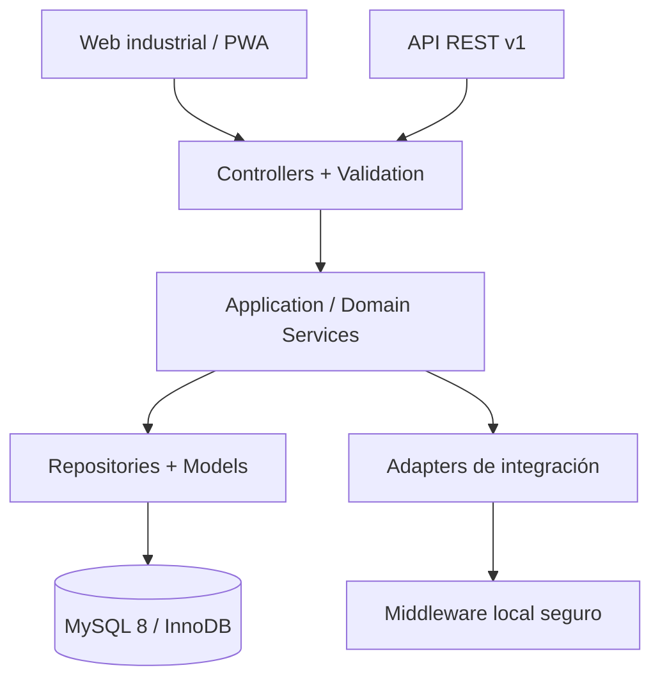
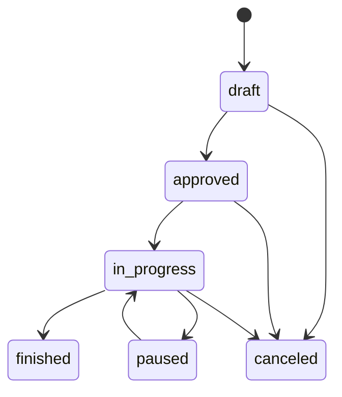
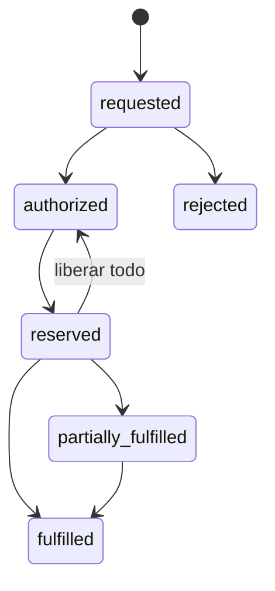

# Diseño funcional aprobado como línea base

Este documento conserva los diecisiete entregables de diseño en el orden solicitado y los vincula con la implementación. La línea base se derivó del prompt y del documento funcional proporcionado; los puntos marcados “pendiente de validación” no se convirtieron en reglas rígidas.

## 1. Alcance funcional

La solución cubre el ciclo físico desde la programación del arribo hasta la salida de materia prima:

1. Catálogos de empresa, instalación, frigorífico, cámara, ubicación, embarcación, tanque, tina, especie, talla, báscula, impresora y defecto.
2. Viaje/marea con fotografía histórica de los tanques de la embarcación y RSA.
3. Planeación por tanque y composición: tonelaje, especie, talla, MSC, Dolphin Safe y temperatura de congelación.
4. Llenado y clasificación de tina con procedencia múltiple normalizada.
5. Pesaje con lectura estable, tara identificada, bruto, neto físico, castigo y neto aceptado.
6. Etiqueta versionada con QR/código de barras, impresión y reimpresión auditada.
7. Inspección y dictamen de calidad independiente del castigo comercial.
8. Recepción en frigorífico; éste es el único evento que crea una unidad de inventario inicial.
9. Inventario por unidad física, lote, almacén, cámara y ubicación; reubicación, merma, ajustes y reversos.
10. Solicitud, autorización, disponibilidad, reserva exacta, liberación y surtido a producción.
11. Traspaso interno/externo con tránsito, recepción y diferencias.
12. Venta y despacho físico; referencias INVoiice/CFDI desacopladas.
13. Conteo y conciliación con fotografía de concurrencia.
14. Dashboard, reportes exportables, auditoría, seguridad, API e integraciones.

Fuera de alcance de esta versión: emisión fiscal dentro de la plataforma; confirmación destructiva offline; implementación de un protocolo industrial no confirmado; contabilidad general; planeación detallada de producción; reconocimiento de imagen por cámaras.

## 2. Arquitectura

Aplicación modular MVC sobre CodeIgniter 4. Los Controllers validan acceso y formato; Services ejecutan casos de uso; Models/Repositories encapsulan persistencia; Entities/DTO conservan contratos; Strategies resuelven reglas variables; Adapters aíslan dispositivos.



`InventoryService` es la frontera única de escritura física. Las transacciones bloquean agregados y unidades con `SELECT ... FOR UPDATE`, actualizan el libro mayor y su proyección, y realizan rollback total ante cualquier excepción.

## 3. Módulos

| Módulo lógico | Implementación principal | Responsabilidad |
|---|---|---|
| Auth, usuarios, roles | Shield, `Modules/Users`, `Modules/Security` | Sesión, recuperación, permisos y alcance |
| Catálogos y configuración | `Modules/Catalogs`, `Modules/Configuration` | Datos maestros y parámetros versionables |
| Embarcaciones, mareas, RSA | `Modules/Maritime` | Identidad marítima e instantánea de tanques |
| Planeación y descarga | `Modules/DischargePlanning` | Plan, composición y llenado de tina |
| Pesaje y lotes | `Modules/Weighing` | Lectura, tara, cálculo y lote |
| Etiquetado | `Modules/Labeling` | Plantilla, QR/barra, impresión e historial |
| Calidad | `Modules/Quality` | Defectos, grado, disposición y retención |
| Recepción | `Modules/Receiving` | Confirmación de ingreso a frigorífico |
| Inventario | `Modules/Inventory` | Libro mayor, proyección, conteos y reversos |
| Solicitudes/reservas/surtido | `Modules/Supply` | Demanda y compromiso de unidades exactas |
| Traspasos | `Modules/Transfers` | Origen, tránsito, destino y diferencias |
| Venta | `Modules/Sales` | Orden y salida física |
| Facturación | `Modules/Billing` | Referencia fiscal sin movimiento de stock |
| Auditoría, reportes, tablero | `Modules/Audit`, `Reports`, `Dashboard` | Evidencia, consulta e indicadores |
| Integraciones | `Modules/Integrations` y adapters | API, báscula, impresora y salud |

Entradas, salidas, mermas, castigos y ajustes no son silos duplicados: son casos de uso y tipos de movimiento dentro de la frontera transaccional de inventario.

## 4. Casos de uso

| Código | Caso de uso | Resultado verificable |
|---|---|---|
| CU-01 | Crear/cerrar/cancelar marea | Viaje, fotografía de tanques y cierre transaccional sin pendientes |
| CU-02 | Registrar RSA | RSA ligado al viaje y vigencia |
| CU-03 | Crear/aprobar plan | Composiciones válidas y capacidad controlada |
| CU-04 | Iniciar/completar tina | Tina y procedencia en estado trazable |
| CU-05 | Capturar pesaje | Pesos separados, lectura original y lote |
| CU-06 | Imprimir/reimprimir | Etiqueta e intento de impresión auditados |
| CU-07 | Inspeccionar/dictaminar | Calidad y posible hold/release/reject |
| CU-08 | Confirmar recepción | Documento, línea, ledger y unidad de stock |
| CU-09 | Reubicar/ajustar/mermar | Movimiento confirmado o rollback |
| CU-10 | Solicitar y autorizar MP | Demanda aprobada por línea |
| CU-11 | Reservar/liberar | Compromiso exacto sin cambiar existencia |
| CU-12 | Surtir reserva | Salida a producción y liberación simultánea |
| CU-13 | Traspasar | Embarque, tránsito, recepción/diferencia |
| CU-14 | Despachar venta | Salida física ligada a orden |
| CU-15 | Registrar CFDI | Evidencia fiscal; `inventory_changed=false` |
| CU-16 | Contar/conciliar | Ajuste compensatorio con control de versión |
| CU-17 | Reversar | Documento nuevo; original preservado |

## 5. Reglas de negocio

- El inventario no existe durante descarga, pesaje o etiquetado; nace en recepción confirmada.
- La unidad trazable es la tina/marbete recibida, no un saldo agregado editable.
- `neto_físico = bruto - tara`; `castigo_kg = neto_físico × porcentaje / 100`; `neto_aceptado = neto_físico - castigo_kg`.
- El pesaje automático consume una captura estable persistida, vigente, del mismo actor y de uso único; el cliente no puede sustituir peso, raw, timestamp, fuente o báscula.
- La tara de catálogo se fotografía en el pesaje. Tara pintada o estimada exige razón; el valor estimado es configurable.
- Castigo, calidad, retención, reserva, disponibilidad y estado físico son dimensiones diferentes.
- Un plan aprobado requiere RSA activo y vigente para el inicio planeado.
- Una marea sólo cierra con todos sus planes resueltos, al menos uno finalizado y sin tinas pendientes; cancelar marea/plan exige motivo y ausencia de operación.
- Una composición requiere MSC, Dolphin Safe y temperatura; los catálogos de certificación se configuran.
- La procedencia multitanque se guarda en `filling_source_tanks`, nunca como texto separado por comas.
- Un lote conserva componentes, modo temporal y versión de regla.
- Una reserva no puede exceder ni la disponibilidad de la unidad ni el saldo de la solicitud.
- Una venta en borrador no simula una reserva; el despacho revalida bajo bloqueo.
- Un CFDI emitido/cancelado no crea, actualiza ni revierte documentos de inventario.
- Ningún documento confirmado se borra físicamente.

## 6. Estados y transiciones

Los flujos centrales usan `StateMachine`; el catálogo completo está en [estados y reglas](04-estados-y-reglas.md).





## 7. Modelo entidad-relación

El modelo se divide en cinco agregados enlazados por referencias explícitas: organización; operación marítima; pesaje/calidad; recepción/inventario; demanda/comercial. No existe una columna que mezcle tanques ni una tabla de “saldo” sin ledger. Véase el diagrama y cardinalidades en [modelo y diccionario](03-modelo-y-diccionario.md).

## 8. Diccionario de datos

Todas las tablas, finalidad, identificadores, relaciones, índices y campos contables críticos están inventariados en [modelo y diccionario](03-modelo-y-diccionario.md). Convenciones: PK numérica `BIGINT UNSIGNED`; UUID para intercambio; fechas `DATETIME`; pesos `DECIMAL(14,3)`; dinero `DECIMAL(14,4)`; auditoría `created_at/updated_at`; concurrencia `lock_version`.

## 9. Endpoints

La API externa está versionada bajo `/api/v1`. Usa `X-API-CLIENT`, `X-API-KEY` e `Idempotency-Key` en escrituras. La API de la interfaz vive en `/internal/v1`, usa sesión Shield y CSRF. Contratos y respuestas están en [OpenAPI](api/openapi.yaml).

Grupos: salud/catálogos; viajes/RSA/planes; llenados; báscula/pesajes; etiquetas; calidad; recepción; movimientos/conteos; solicitudes/reservas/surtido; traspasos; ventas; referencias fiscales.

## 10. Estructura del proyecto CodeIgniter 4

```text
app/
  Common/                 # Dominio transversal, filtros, soporte y servicios
  Config/                 # Rutas, DI, Shield, seguridad y catálogos
  Database/               # Migrations, Seeders y Factories
  Modules/<Modulo>/       # Controllers, Services, Repositories/Models, DTO/Entities, Views
  Views/layouts/          # Shell empresarial
public/                   # Único DocumentRoot; PWA y assets locales
tests/unit|database/      # Reglas puras y procesos transaccionales
infra/apache|nginx|php/   # Despliegue
scripts/                  # Instalación, update, backup y restore
docs/                     # Documentación operativa y técnica
```

## 11. Perfiles y permisos

Hay veinte grupos: propietario de proceso, identidad, datos maestros, planeación, supervisión, clasificador, etiquetador, pesador, calidad, almacén, producción, venta, facturación, contraloría, auditoría, soporte y almacén externo. La matriz exacta se mantiene en `Config/AuthGroups.php` y se documenta en [roles y permisos](05-roles-y-permisos.md).

## 12. Mockups

La implementación usa un shell responsive con navegación por permiso y tres patrones:

| Pantalla | Zona prioritaria | Interacción |
|---|---|---|
| Centro de operación | KPI, red, colas y tonelaje | Lectura rápida |
| Planeación | Viaje/RSA, tanque y composición | Formularios guiados y transiciones |
| Estación de pesaje | Tina, bruto/tara/netos, escala, etiqueta | Botones grandes, teclado/táctil |
| Recepción | Etiquetas pendientes y ubicación | Selección mínima y confirmación explícita |
| Inventario | Unidad/lote/ubicación/estado | Búsqueda, filtros y exportación |
| Solicitudes | Cobertura, selección exacta y surtido | Modal con unidades disponibles |
| Conteos/traspasos/ventas | Unidad física y destino | Revalidación al confirmar |

Estados de red, báscula e impresora son visibles. Los botones destructivos quedan deshabilitados offline y cuentan con confirmación SweetAlert2.

## 13. Estrategia de integración con báscula

`ScaleAdapterInterface` define conexión, desconexión, lectura, lectura estable, estado e información. Los adapters RS-232, USB serial y TCP no inventan parsing: exigen middleware configurado. El navegador consulta al backend; el backend usa HTTPS/API key hacia un agente local. Cada lectura se persiste antes de confirmar, queda ligada al actor y sólo puede reclamarse una vez dentro de su vigencia. Conserva peso, unidad, estabilidad, relojes, báscula, valor original, hash, conexión y fuente. Detalle en [integraciones](06-integraciones.md).

## 14. Estrategia de impresión

`LabelPrinterInterface` ofrece imprimir, reimprimir, estado y cancelar. Hay browser, PDF y middleware local; ZPL se renderiza desde una plantilla versionada, pero la impresora Zebra permanece inactiva hasta validar modelo/transporte. Cada trabajo registra etiqueta, plantilla, versión, impresora, usuario, intento, reimpresión, motivo, resultado y respuesta saneada.

## 15. Estrategia de migración desde Excel

Se aplica staging, normalización, validación, conciliación, aprobación y carga idempotente. `import_batches` e `import_rows` guardan hash, fila original, normalizada, errores y entidad creada. Ninguna hoja se importa directamente a inventario confirmado. Véase [migración Excel](07-migracion-excel.md).

## 16. Plan de pruebas

Se cubren fórmulas, lote, calidad, máquinas de estado, permisos, simulador, recepción, duplicidad, reserva, surtido, reverso, conteo concurrente, traspaso entre instalaciones, diferencia, báscula duplicada, idempotencia, planeación/capacidad/RSA, ciclo de mareas y aislamiento fiscal. El detalle y criterios de aceptación están en [plan de pruebas](08-plan-pruebas.md).

## 17. Riesgos y supuestos pendientes

| Riesgo o decisión | Estado | Mitigación incorporada |
|---|---|---|
| Protocolo de báscula desconocido | Pendiente | Interface + middleware + simulador explícito |
| Zebra/modelo/transporte | Pendiente | Adapter, ZPL, PDF y dispositivo inactivo |
| Traslape del 15% en calidad | Pendiente | Automatización desactivada; dictamen manual |
| Mes vs. día juliano en lote | Configurable | Strategy y versión de regla |
| Estructura de Excel | Pendiente de muestra | Staging y mapeo por versión |
| Motivos/castigos definitivos | Pendiente | Razón obligatoria y configuración |
| Capacidades/topología reales | Pendiente de levantamiento | Catálogos y restricciones de integridad |
| Calidad de red intranet | Operativo | PWA estática; bloqueo de confirmación offline |
| Integración fiscal futura | Contrato por confirmar | Referencia desacoplada y API idempotente |
| Retención legal/privacidad | Por política | Auditoría separada, sin secretos, política configurable |
