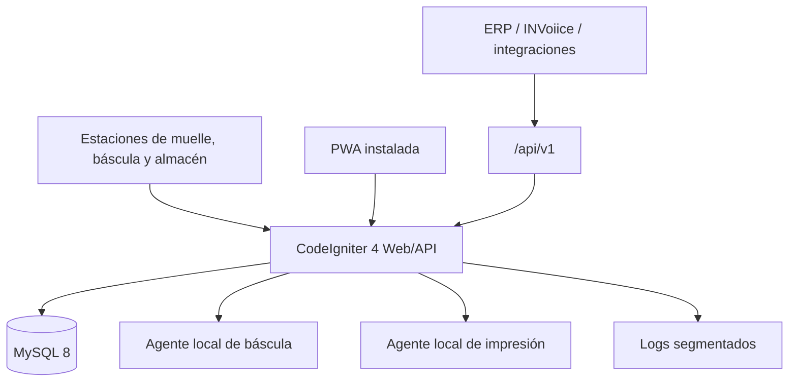
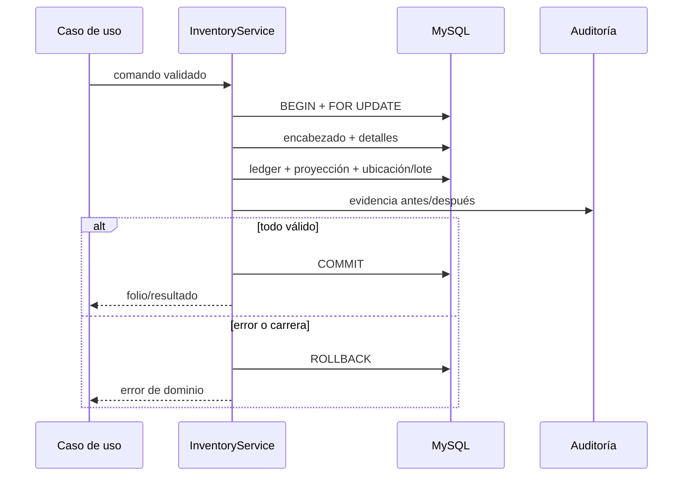
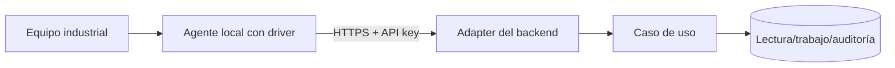

# Arquitectura técnica

## Contexto y objetivos

La plataforma soporta operación industrial en intranet, donde una pérdida de consistencia es más costosa que una demora. Se priorizan trazabilidad, concurrencia, permisos en servidor, recuperación y desacoplamiento de equipos. CodeIgniter 4 es el único framework backend y MySQL 8 la única base operativa.

## Contenedores lógicos

Los recursos frontend se sirven localmente para que la intranet no dependa de CDN. El service worker sólo cachea el shell y recursos estáticos; nunca intercepta una escritura para almacenarla y reenviarla después.

## Capas y dependencias

1. **Controllers**: reciben request, ejecutan validación CodeIgniter, comprueban agregado/alcance y transforman a response.
2. **Application Services**: coordinan casos de uso y transacciones.
3. **Domain Services/Strategies**: cálculos, folios, lotes, calidad y transiciones.
4. **Repositories/Models**: queries especializadas, bloqueos y persistencia.
5. **Entities/DTO**: contratos tipados de pesaje e inventario.
6. **Adapters**: báscula e impresora sin dependencia del fabricante.
7. **Infrastructure**: MySQL, HTTP local, archivos PDF, logs y servidor web.

Una capa sólo depende hacia dentro. Los Controllers no alteran saldos; los adapters no conocen vistas; la facturación no invoca inventario.

## Módulos físicos

Los namespaces siguen `App\Modules\<Modulo>`. Un módulo contiene únicamente carpetas que necesita. La lógica transversal reside en `App\Common`; la configuración del contenedor de servicios está en `Config\Services`.

No se separan módulos en bases distintas: se conserva una transacción ACID única para la operación. La modularidad es de código y dominio, no una distribución prematura.

## Transacción de inventario

`inventory_movements` es el libro mayor confirmado. `stock_units` es una proyección transaccional para respuesta operativa rápida; sus saldos deben poder conciliarse contra el ledger. Cada documento conserva origen/destino, usuario, momento, motivo y referencia documental. El bloqueo optimista `lock_version` detecta fotografías obsoletas; el bloqueo pesimista protege la confirmación concurrente.

## Identidad y autorización

- Shield administra usuarios, autenticadores, sesiones, recuperación y grupos.
- Los filtros `session` y `permission` protegen páginas/endpoints internos.
- `OperationalScopeFilter` exige empresa/instalación/almacén autorizado.
- `ScopeContext` comprueba payloads, líneas y agregados, no sólo IDs visibles.
- La API usa cliente + secreto hash, permiso por endpoint, rate limit e idempotencia.
- `identity_admin` y `process_owner` están protegidos contra auto-desactivación accidental.

## Seguridad de aplicación

- CSRF por sesión en web/internal API; API externa usa secreto y no CSRF.
- Query Builder y parámetros enlazados; sin concatenación de datos del usuario en SQL.
- Escape de salida en vistas y JSON seguro para bloques de datos.
- CSP, `nosniff`, anti-frame, referrer y permissions policy.
- Cookies seguras y HTTPS configurables; errores técnicos ocultos en producción.
- Rate limiting en login y API; claves almacenadas como hash SHA-256.
- Configuraciones sensibles no se muestran ni se editan desde la consola genérica.
- Cargas futuras deben ir a `writable/uploads`, fuera de `public`, con MIME/tamaño/nombre interno.

## Datos y concurrencia

- InnoDB, FKs, checks e índices compuestos según consulta operativa.
- PK numérica local y UUID para referencias externas/idempotentes.
- Pesos `DECIMAL`, nunca `FLOAT` en persistencia.
- Relaciones N:M normalizadas (`filling_source_tanks`, detalles y líneas).
- `v_available_stock` centraliza existencia menos reserva para lectura.
- Documentos confirmados son append-only desde el dominio; la corrección crea compensación.

## Integraciones

La frontera industrial usa adapters. Para puertos serie o USB, el proceso recomendado es:

El agente debe permitir lista blanca de servidor, TLS, secreto rotatorio, reloj sincronizado, timeout, health-check y spool sólo para impresión. No puede confirmar inventario por sí mismo.

## Observabilidad

`OperationalLogger` enruta categorías a archivos separados en `writable/logs`: aplicación, seguridad, integraciones, básculas, impresión, inventario, errores y auditoría. Las tablas `integration_events`, `security_events`, `scale_readings`, `print_jobs` y `audit_logs` aportan evidencia consultable. Tokens, contraseñas y configuraciones sensibles deben sanearse.

## Despliegue

- **Linux/Apache**: virtual host incluido, PHP-FPM no requerido.
- **Linux/Nginx**: configuración de `try_files` y PHP-FPM incluida.
- **Windows Server**: Apache/Nginx y scripts PowerShell; ajustar ACL de `writable`.
- **Docker**: imagen PHP 8.2/Apache + MySQL 8.4, volúmenes persistentes.

Ambientes se separan con `.env`; no se incorporan secretos al repositorio. Producción requiere TLS, `CI_ENVIRONMENT=production`, cookies seguras, permisos mínimos de DB y respaldos verificados.

## Decisiones arquitectónicas

| Decisión | Motivo | Consecuencia |
|---|---|---|
| Monolito modular | Consistencia ACID y equipo inicial | Despliegue simple; módulos extraíbles después |
| Ledger + proyección | Auditoría y rendimiento | Requiere conciliación automática |
| Inventario nace en recepción | Distinguir proceso vs. existencia | Pesaje no infla stock |
| Unidad física específica | Trazabilidad industrial | Más filas; selección confiable |
| Fiscal desacoplado | INVoiice conserva autoridad | CFDI no altera stock |
| Middleware de dispositivos | Navegador no controla puertos industriales | Hay que desplegar un agente local |
| Sin escritura offline | Evitar conflictos destructivos | La operación espera conectividad |
| Reverso, no edición | Evidencia inmutable | Correcciones generan más documentos |

## Escalabilidad

La primera escala es vertical: índices, paginación, vistas y separación de workers de integración. Si el volumen lo exige, reportes históricos pueden replicarse a un almacén analítico sin cambiar la fuente operativa. La API y los adapters permiten dividir integraciones antes que el núcleo transaccional.
