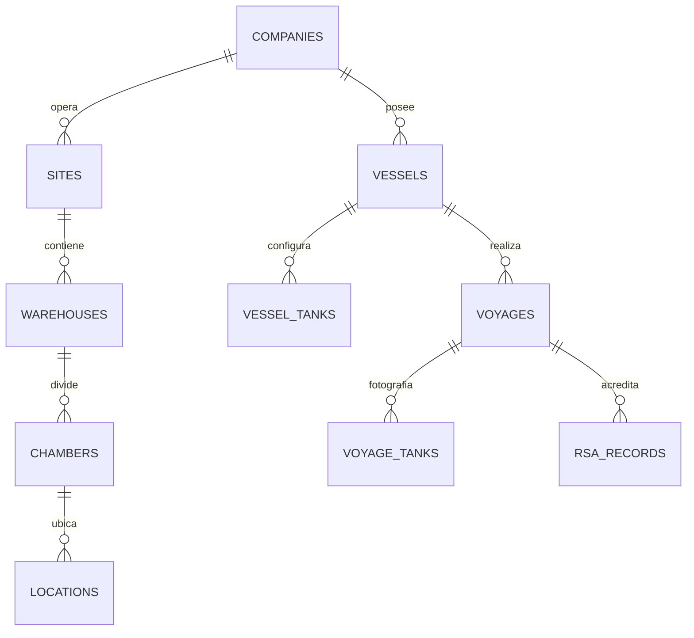
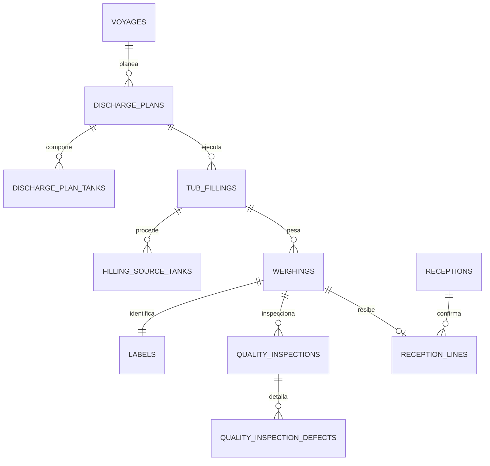
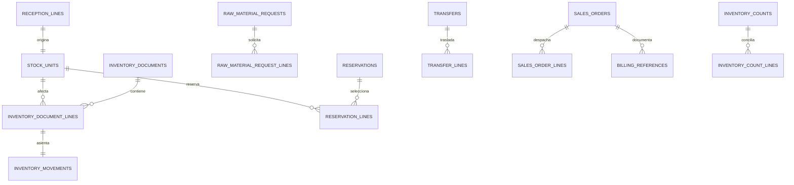

# Modelo entidad-relación y diccionario de datos

## Convenciones

| Convención | Definición |
|---|---|
| `id` | PK local `BIGINT UNSIGNED AUTO_INCREMENT` |
| `uuid` | Identificador público/integración `CHAR(36)` único |
| `*_id` | FK explícita; no se guardan listas separadas por comas |
| `*_weight_kg` | Peso `DECIMAL(14,3)` en kilogramos |
| `*_at` | Momento `DATETIME`; la aplicación usa la zona de la instalación |
| `created_at`, `updated_at` | Auditoría temporal del registro |
| `created_by`, `*_by` | Usuario responsable del evento |
| `lock_version` | Control optimista; aumenta en cada transición crítica |
| `status` | Código estable documentado, no etiqueta traducida |
| `active` | Baja lógica para catálogos |

Todas las tablas se crean con InnoDB, `utf8mb4` y `utf8mb4_0900_ai_ci`. Los DDL completos y ejecutables están en `app/Database/Migrations`.

## Relaciones: organización y operación marítima

## Relaciones: descarga, pesaje, calidad y recepción

## Relaciones: inventario, suministro y comercial

## Organización y catálogos

| Tabla | Finalidad | Campos principales y reglas |
|---|---|---|
| `companies` | Empresas propietarias, clientes, proveedores o frigoríficos externos | `code`, `legal_name`, `trade_name`, `tax_id`, `company_type`, `active`; código único |
| `sites` | Instalaciones operativas | `company_id`, `code`, `name`, `timezone`, `address`, `active`; único por empresa/código |
| `warehouses` | Frigoríficos, producción, tránsito o almacenes externos | `company_id`, `site_id`, `external_company_id`, `code`, `name`, `warehouse_type`, `active` |
| `chambers` | Cámaras térmicas | `warehouse_id`, `code`, `name`, `min_temperature_c`, `max_temperature_c`, `active` |
| `locations` | Árbol zona/fila/pasillo/posición/nivel | `warehouse_id`, `chamber_id`, `parent_id`, `code`, `path`, `location_type`, capacidades, `segregation_rule`, `active` |
| `vessels` | Embarcaciones maestras | `owner_company_id`, `code`, `name`, matrícula, bandera, capacidad, `active` |
| `vessel_tanks` | Configuración física vigente por embarcación | `vessel_id`, `tank_number`, `side`, `capacity_kg`, `active`; número único por barco |
| `species` | Especies | `code`, `name`, `scientific_name`, `active`; código y nombre únicos |
| `size_grades` | Tallas generales o por especie | `species_id`, `code`, `name`, `min_kg`, `max_kg`, `active`; mínimo no mayor al máximo |
| `tubs` | Tinas y tara vigente | `company_id`, `code`, `barcode`, `current_tare_kg`, `tare_verified_at`, `status`, `lock_version`, `active` |
| `scales` | Básculas registradas | `site_id`, `code`, `connection_type`, `adapter_key`, JSON `configuration`, calibración, `active` |
| `printers` | Impresoras registradas | `site_id`, `code`, `printer_type`, `adapter_key`, JSON `configuration`, `active` |
| `quality_defects` | Catálogo de defectos | `code`, `name`, destino sugerido, `requires_hold`, `active` |
| `state_catalog` | Catálogo visible de estados | `aggregate`, `code`, `name`, terminal, orden, `active`; par único |
| `system_settings` | Parámetros jerárquicos | `company_id`, `site_id`, `setting_key`, `value_type`, `setting_value`, `is_sensitive`; clave única por alcance |

## Marítimo y planeación

| Tabla | Finalidad | Campos principales y reglas |
|---|---|---|
| `voyages` | Viaje/marea | UUID, empresa, sitio, embarcación, frigorífico receptor, número anual, año, puerto, arribo, inicio/fin, estado y versión; viaje único por barco/año/número |
| `voyage_tanks` | Fotografía histórica de tanques | `voyage_id`, `vessel_tank_id`, número, banda, capacidad y tonelaje planeado; no cambia si el maestro cambia |
| `rsa_records` | RSA del viaje | `voyage_id`, `code`, emisión, expiración, estado, documento; código único |
| `discharge_plans` | Encabezado del plan | UUID, folio, `voyage_id`, `rsa_id`, ventana planeada, estado, aprobador, notas y versión |
| `discharge_plan_tanks` | Composición planificada por tanque | plan, tanque de viaje, especie, talla, peso, `msc_code`, `dolphin_safe_code`, temperatura, secuencia y estado |
| `tub_fillings` | Ejecución de llenado/clasificación | plan, tina, tanque real, especie, talla, sorter, etiquetador, inicio/fin, estado, observaciones y versión |
| `filling_source_tanks` | Procedencias N:M de una tina | `tub_filling_id`, `voyage_tank_id`, `is_primary`; par único |

## Pesaje, etiqueta, calidad y recepción

| Tabla | Finalidad | Campos principales y reglas |
|---|---|---|
| `lots` | Identidad de lote reproducible | UUID, código, tipo, viaje, componentes barco/especie/marea/período/año, `rule_version`, estado; código único |
| `weighings` | Evento metrológico | UUID/folio, llenado/tina/lote, `scale_id` y `scale_reading_id`, bruto, tara, fuente/motivo, neto físico, castigo %, castigo kg, neto aceptado, fuente/estabilidad/raw/timestamp, estado, actual, usuarios y versión |
| `label_templates` | Plantilla versionada | código, nombre, versión, formato HTML/ZPL, cuerpo, `active`; código+versión único |
| `labels` | Identidad de marbete | UUID/código, pesaje, plantilla, QR, valor de barras, estado, creador; una etiqueta lógica por código |
| `print_jobs` | Historial de intentos | etiqueta, plantilla/versión, impresora, intento, `is_reprint`, motivo, formato, payload hash, resultado, respuesta/error saneado, usuario y fecha |
| `quality_inspections` | Inspección/dictamen | UUID, pesaje, grado, porcentaje, temperatura, disposición, estado, inspectores/aprobadores, observaciones |
| `quality_inspection_defects` | Defecto medido | inspección, defecto, porcentaje, observación; único por inspección/defecto |
| `receptions` | Documento de ingreso físico | UUID/folio, empresa/sitio/almacén, estado, usuario/fecha, observaciones y versión |
| `reception_lines` | Pesajes recibidos | recepción, pesaje, etiqueta, ubicación, peso aceptado, calidad y estado; pesaje único para evitar doble recepción |

## Inventario

| Tabla | Finalidad | Campos principales y reglas |
|---|---|---|
| `inventory_documents` | Encabezado inmutable de movimiento | UUID/folio, tipo, estado, alcance, almacenes, documento origen/destino, reverso, motivo, usuario/fecha y versión |
| `inventory_document_lines` | Detalle por unidad | documento, secuencia, stock/lote, almacén y ubicación antes/después, cantidad, estado antes/después |
| `inventory_movements` | Libro mayor append-only | UUID, documento/línea, unidad/lote, tipo, delta físico, delta reservado, ubicaciones, saldos resultantes, actor y fecha |
| `stock_units` | Proyección operativa por tina/marbete | UUID/código, alcance/ubicación, recepción/pesaje/etiqueta/tina/lote/producto/calidad, peso original/en mano/reservado, estado, hold y versión |
| `stock_unit_location_history` | Historia de ubicación | unidad, movimiento, origen, destino, usuario y fecha |
| `inventory_counts` | Encabezado de conteo | UUID/folio, almacén/ubicación, estado, responsables, fechas, motivo y versión |
| `inventory_count_lines` | Fotografía y resultado contado | conteo, unidad, ubicación/saldo/versión esperados, ubicación/peso contados, diferencia, resultado y usuario |
| `v_available_stock` | Vista de consulta | unidad, dimensiones y `available_weight_kg = on_hand - reserved`; sólo estados utilizables según consulta |

Invariantes de `stock_units`: pesos no negativos; reservado no mayor que existencia; identificadores de recepción, pesaje y etiqueta únicos. `inventory_movements` guarda el saldo resultante para poder auditar cada paso.

## Solicitudes, reservas, traspasos y comercial

| Tabla | Finalidad | Campos principales y reglas |
|---|---|---|
| `raw_material_requests` | Demanda a producción | UUID/folio, alcance, destino, prioridad, requerido, estado, solicitante/autorizador/rechazo, observación y versión |
| `raw_material_request_lines` | Criterio y avance | solicitud, secuencia, especie, talla, calidad, kg solicitados/reservados/surtidos y estado |
| `reservations` | Compromiso temporal | UUID/folio, solicitud, estado, expiración, creación/liberación/motivo y versión |
| `reservation_lines` | Unidad exacta reservada | reserva, línea solicitada, `stock_unit_id`, kg reservados/surtidos y estado |
| `transfers` | Encabezado de traspaso | UUID/folio, empresa, almacenes, estado, responsables, fechas, transportista, observaciones y versión |
| `transfer_lines` | Unidad en tránsito | traspaso, secuencia, unidad, kg enviados/recibidos/diferencia, ubicaciones y estado |
| `sales_orders` | Orden física de venta | UUID/folio, empresa/sitio, cliente, estado, fecha requerida, responsables, despacho, observación y versión |
| `sales_order_lines` | Unidad seleccionada para venta | orden, secuencia, unidad, kg, precio unitario, moneda y estado |
| `billing_references` | Evidencia fiscal externa | empresa/sitio, orden opcional, sistema/ID externo, tipo, UUID fiscal, estado, emisión/cancelación, fingerprint y usuario; no contiene deltas de inventario |

## Seguridad, integraciones, auditoría e importación

| Tabla | Finalidad | Campos principales y reglas |
|---|---|---|
| `operational_user_scopes` | Alcances del usuario | usuario Shield, empresa, sitio/almacén/estación, `active`; combinación única |
| `api_clients` | Credenciales de integración | `client_id`, nombre, `key_hash`, permisos JSON, alcance, `active`, último uso |
| `api_idempotency_keys` | Reproducción segura | hash de owner+método+ruta+clave, hash de payload, estado/respuesta y expiración |
| `scale_readings` | Evidencia de báscula | UUID, báscula/pesaje, peso/unidad/estabilidad, reloj de dispositivo/servidor, raw/hash, conexión, fuente, identificador de equipo y actor usuario/cliente; huella duplicada restringida y captura reclamable una sola vez |
| `integration_endpoints` | Sistemas externos configurados | código, tipo, URL, credencial referenciada, estado/health, `active` |
| `integration_events` | Entrada/salida técnica | endpoint, dirección, tipo, correlación, request/response saneados, resultado, reintentos y tiempos |
| `audit_logs` | Bitácora funcional | UUID, actor usuario/servicio/cliente API, referencia de actor, acción, agregado, alcance, before/after JSON, razón, IP, user agent, correlación y momento |
| `security_events` | Eventos de seguridad | tipo, severidad, usuario/client/IP, detalle saneado y fecha |
| `import_batches` | Lote de migración | UUID, tipo, archivo, hash, versión de mapeo, alcance, estado, totales y responsables |
| `import_rows` | Staging por fila | lote, número, raw/normalizado JSON, validación/errores y entidad creada; fila única por lote |

Las tablas propias de Shield (`users`, identidades, grupos, permisos, tokens y login attempts) son creadas por las migraciones del paquete oficial y no se duplican en el dominio.

## Índices operativos

Los índices principales siguen los accesos reales: alcance+estado+fecha; disponibilidad por almacén/producto/calidad; unidad+momento en ledger; lote+momento; ubicación+estado; solicitud/reserva+estado; viaje/plan+estado; externo+ID en facturación; fingerprint de lectura e idempotencia. La validación de rendimiento debe repetirse con volúmenes reales y `EXPLAIN ANALYZE` antes del go-live.
