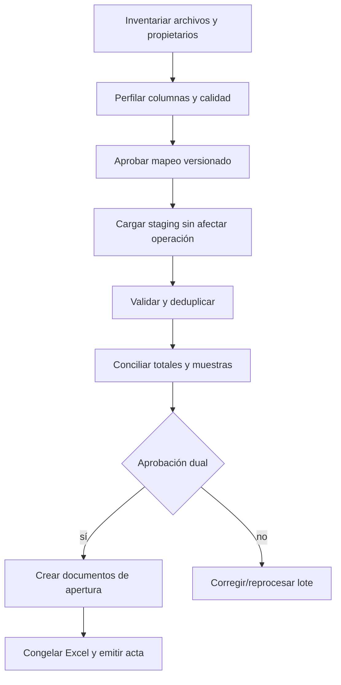

# Estrategia de migración desde Excel

## Objetivo

Migrar catálogos y saldos históricos sin convertir una hoja en autoridad directa de inventario. El formato real de los libros no fue entregado; por eso no se fija un mapeo ficticio. La implementación aporta `import_batches` e `import_rows` para staging, hash, validación, errores e idempotencia.

## Secuencia obligatoria

## Inventario de fuentes

Por cada archivo registrar: nombre lógico, propietario, ubicación, período, hoja, tamaño, filas, zona horaria, fórmula/macro, columnas ocultas, claves aparentes y nivel de confidencialidad. El archivo se copia a almacenamiento de migración de sólo lectura y se calcula SHA-256; el nombre original no se usa como ruta pública.

## Mapeo versionado

Antes de programar el importador se debe recibir al menos una muestra anonimizada de cada plantilla. Crear una especificación `mapping_version`, por ejemplo:

| Columna origen | Entidad/campo | Transformación | Catálogo | Regla de rechazo |
|---|---|---|---|---|
| `Barco` | `vessels.code` | trim/mayúsculas | embarcaciones | código desconocido |
| `Marea` | `voyages.annual_number` | entero | viaje+año+barco | duplicado/ausente |
| `Tina` | `tubs.code` | normalización aprobada | tinas | no registrada |
| `Peso bruto` | `weighings.gross_weight_kg` | decimal/locale | — | <= tara |
| `Tara` | snapshot de pesaje | decimal | fuente de tara | sin procedencia |
| `Lote` | componentes, no sólo texto | parseo versionado | regla de lote | no reproducible |
| `Ubicación` | `locations.path` | lookup exacto | ubicación | ambiguo/inactivo |

La tabla es ilustrativa; debe reemplazarse por nombres reales antes de codificar la importación.

## Staging

`import_batches` conserva UUID, tipo, archivo, hash, versión de mapeo, empresa/sitio, estado, conteos y responsables. `import_rows` conserva número de fila, JSON original, JSON normalizado, errores, estado y entidad creada.

Estados propuestos del lote: `uploaded`, `profiling`, `validated`, `rejected`, `approved`, `importing`, `completed`, `failed`, `reconciled`. La promoción debe ejecutarse en lotes controlados y reanudables, con clave natural/UUID idempotente.

## Validaciones mínimas

- Archivo no repetido por hash, salvo reproceso explícito.
- Fechas y decimales interpretados con locale conocido; no confiar en formato visual de Excel.
- Códigos normalizados sin crear catálogos silenciosamente.
- Empresa, instalación, almacén y ubicación compatibles.
- Barco/marea/tanque/tina/especie/talla existentes o aprobados para alta.
- Peso bruto, tara, neto físico y neto aceptado conciliables.
- Reserva no mayor a existencia; no importar negativos.
- Unicidad de marbete, pesaje, lote y documento.
- Fórmulas evaluadas comparadas contra valor almacenado; macros excluidas.
- Filas vacías, subtotales y encabezados repetidos identificados.

## Carga de saldos iniciales

Un saldo inicial no se inserta directamente en `stock_units`. Por cada unidad física validada se crea un documento de apertura/ajuste autorizado con detalle y ledger, o una recepción histórica cuando exista evidencia completa. Debe conservar `source_document_type=excel_import`, `source_document_id=import_batch_id` y referencia de fila.

Si la fuente sólo tiene saldos agregados, se detiene la carga hasta acordar cómo representar unidades físicas; no se inventan tinas/marbetes.

## Conciliación y aceptación

Comparar antes y después por:

- archivo/hoja y total de filas;
- empresa, instalación, almacén, cámara y ubicación;
- barco, marea, lote, especie, talla y calidad;
- número de unidades;
- bruto, tara, neto físico, castigo y neto aceptado;
- existencia, reserva y disponible;
- rechazadas/omitidas con motivo.

La aceptación requiere firma de Operaciones y Contraloría, muestra trazable de al menos 30 unidades o una muestra estadística acordada, y cero diferencias no explicadas.

## Ensayos

1. Perfilado en copia anonimizada.
2. Dry run sólo a staging.
3. Carga completa en ambiente de pruebas.
4. Pruebas de usuario y reportes de conciliación.
5. Ensayo cronometrado de cutover y rollback.
6. Carga productiva en ventana congelada.
7. Verificación post-carga y acta.

## Cutover y rollback

- Respaldar MySQL y verificar checksum/restauración antes de comenzar.
- Congelar captura en Excel y anotar hora/zona.
- Importar sólo lotes aprobados.
- Si falla antes de confirmar, rollback del lote.
- Si ya hay documentos confirmados, compensar mediante reversos; no borrar.
- Mantener Excel en sólo lectura como evidencia, no como sistema paralelo.

## Pendientes para construir el importador específico

Archivos muestra, propietarios, hojas, diccionario de columnas, llaves naturales, reglas de filas corregidas, volumen, datos históricos a conservar, locale/zonas, estrategia de unidades agregadas y criterio formal de aceptación. Hasta contar con eso, cualquier importador “completo” sería una simulación peligrosa.
